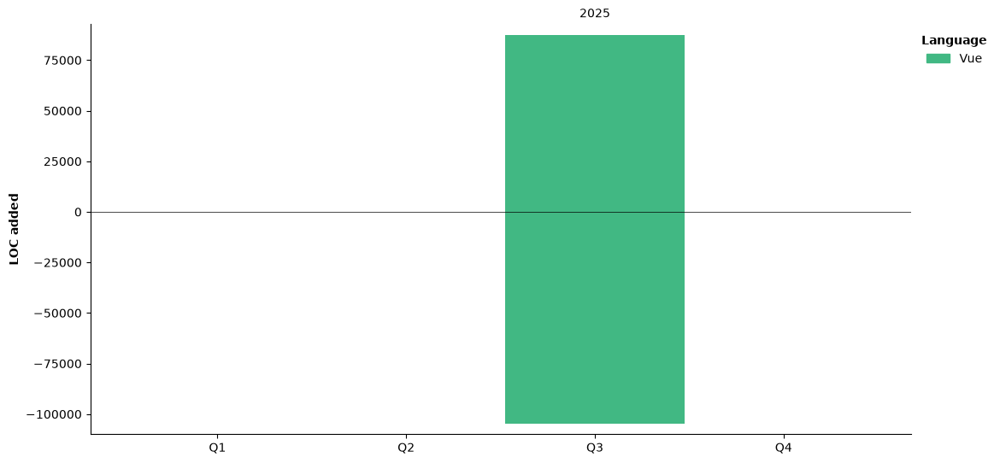

<div align="center">
  <table>
    <tr>
      <td>
        
      </td>
      <td>
       
      </td>
    </tr>
    <tr>
      <td colspan=2>
        <picture>
          <source 
            media="(prefers-color-scheme: dark)" 
            srcset="https://raw.githubusercontent.com/DragonIsGone/DragonIsGone/output/github-contribution-grid-snake-dark.svg"
          >
          <source 
            media="(prefers-color-scheme: light)" 
            srcset="https://raw.githubusercontent.com/DragonIsGone/DragonIsGone/output/github-contribution-grid-snake.svg"
          >
          
  </picture>
      </td>
  </table>

  <table>
<tr>
      <td>
        <div align="center">
          
<!--START_SECTION:waka-->


📅 **I'm Most Productive on Tuesday** 

```text
Monday                   28 commits          ███░░░░░░░░░░░░░░░░░░░░░░   13.86 % 
Tuesday                  96 commits          ████████████░░░░░░░░░░░░░   47.52 % 
Wednesday                48 commits          ██████░░░░░░░░░░░░░░░░░░░   23.76 % 
Thursday                 26 commits          ███░░░░░░░░░░░░░░░░░░░░░░   12.87 % 
Friday                   1 commits           ░░░░░░░░░░░░░░░░░░░░░░░░░   00.50 % 
Saturday                 0 commits           ░░░░░░░░░░░░░░░░░░░░░░░░░   00.00 % 
Sunday                   3 commits           ░░░░░░░░░░░░░░░░░░░░░░░░░   01.49 % 
```


📊 **This Week I Spent My Time On** 

```text
🕑︎ Time Zone: Australia/Melbourne

💬 Programming Languages: 
No Activity Tracked This Week

🔥 Editors: 
No Activity Tracked This Week

🐱‍💻 Projects: 
No Activity Tracked This Week

💻 Operating System: 
No Activity Tracked This Week
```

🤖 **AI Coding This Week** 

```text
No AI Coding Activity Tracked This Week
```

**Timeline**




 Last Updated on 01/11/2026 04:47:57 UTC
<!--END_SECTION:waka-->

  </div></td></tr>
</table>


